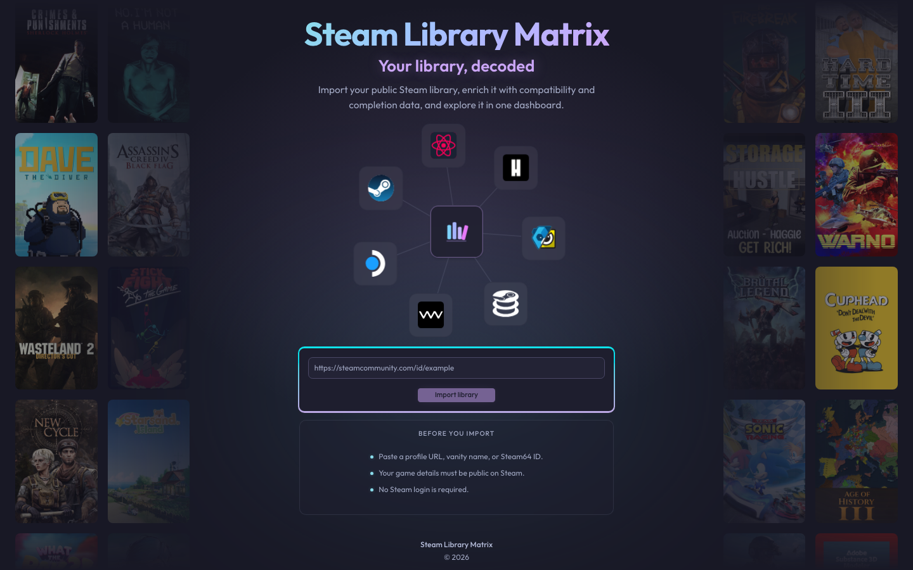
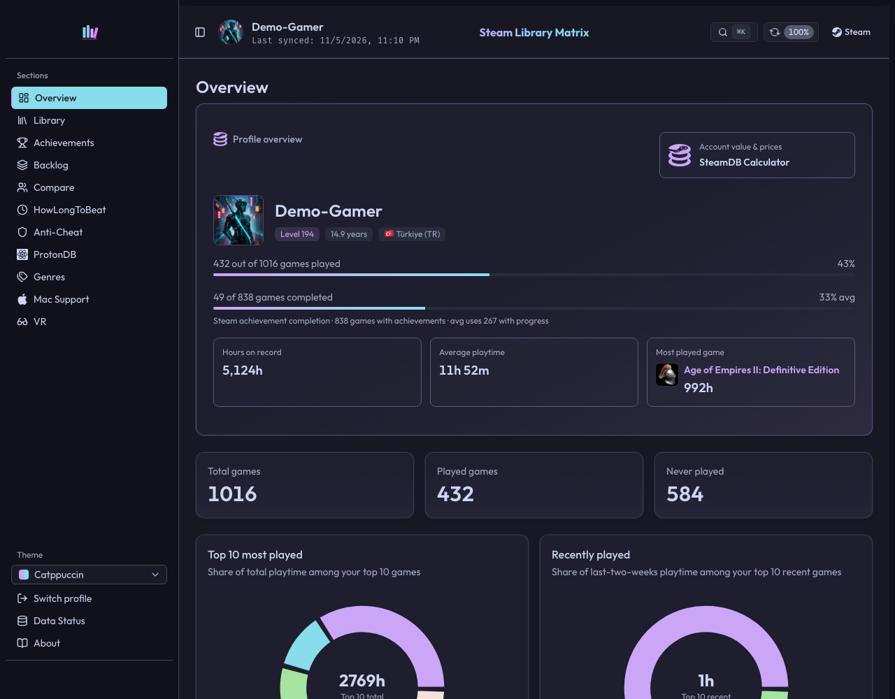
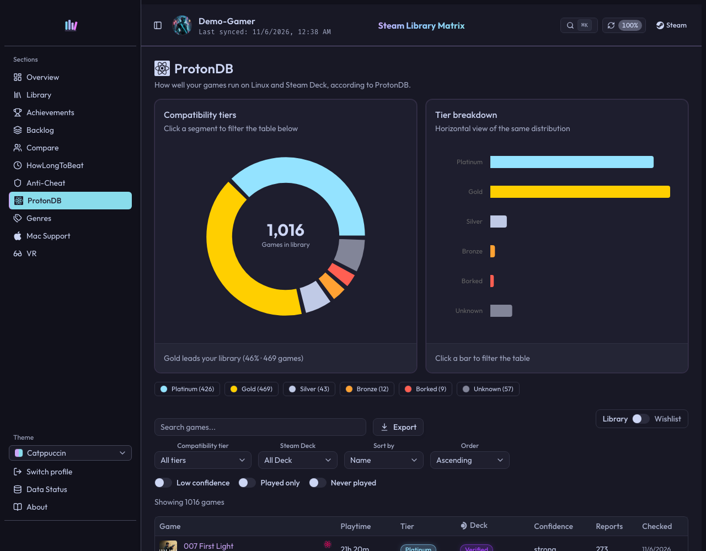
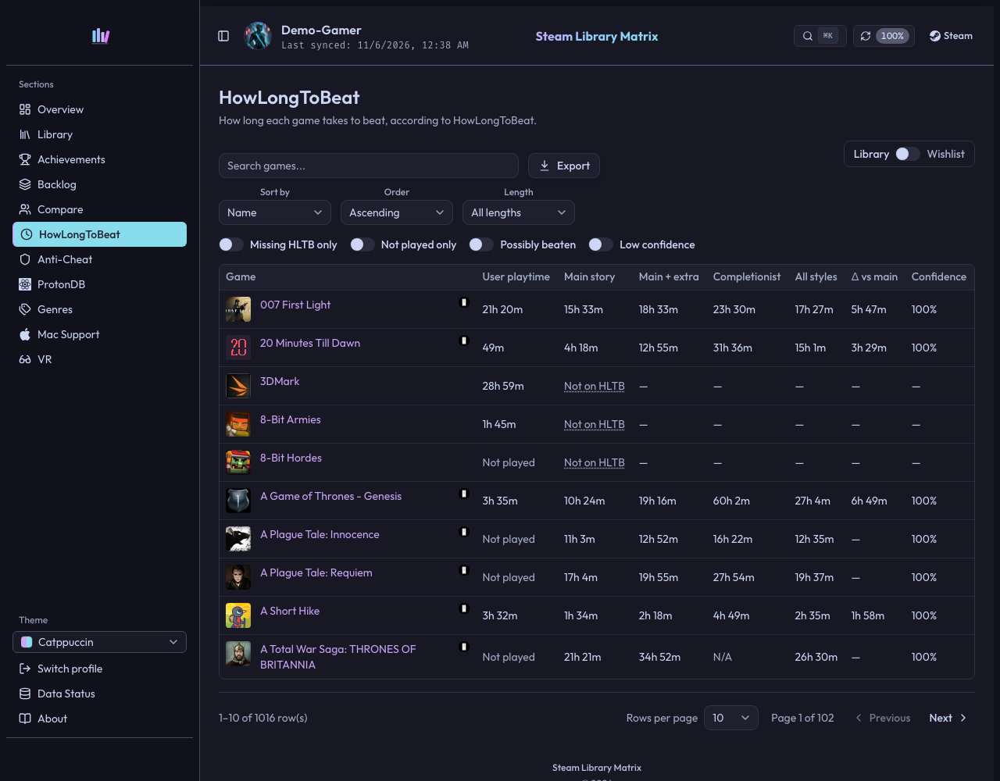
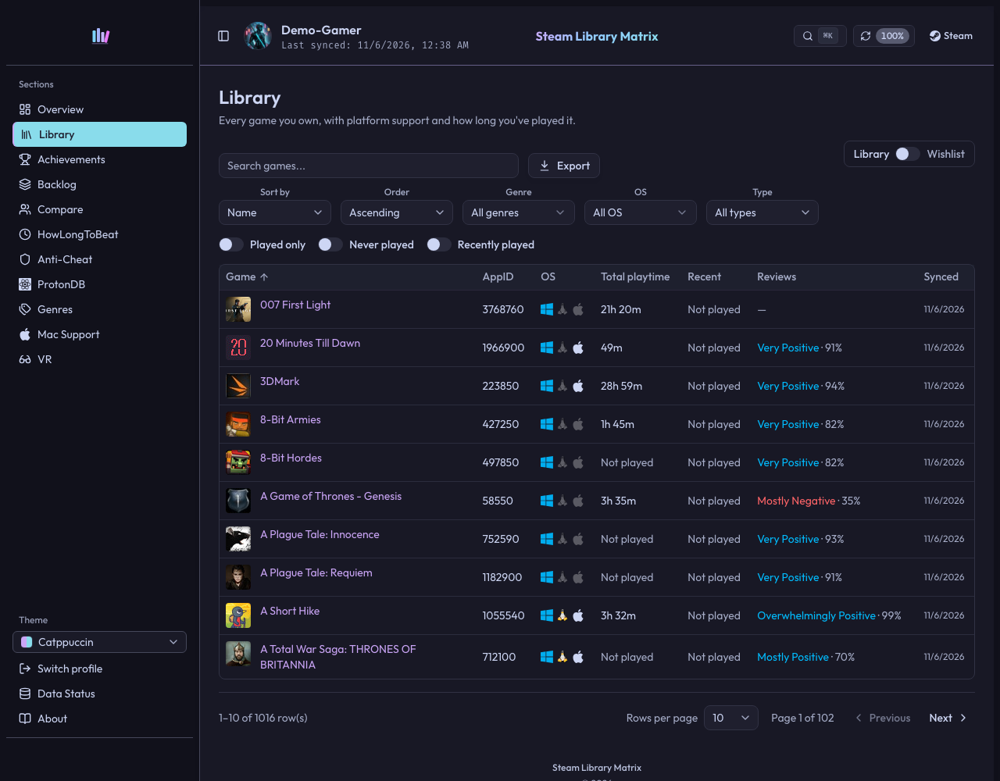
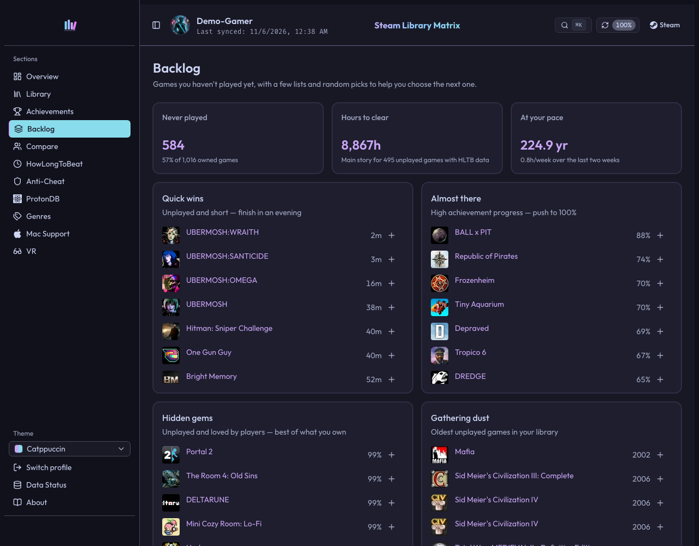
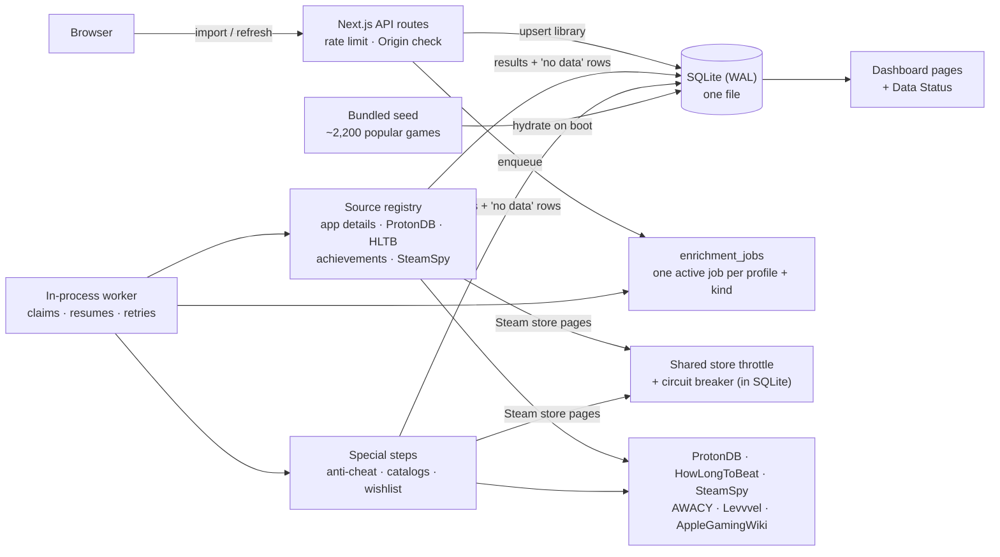

# Steam Library Matrix

Import a public Steam profile and see your whole library in one dashboard: Linux and Steam Deck compatibility, anti-cheat and Denuvo status, completion times, Steam reviews, Mac and VR support, achievements and backlog.

It runs on your own machine as one Next.js process and one SQLite file. There is no cloud backend.

[docs/architecture.md](docs/architecture.md) explains how it works end to end.

## Screenshots

| Landing | Overview |
| :---: | :---: |
|  |  |
| Paste a public profile URL, vanity name or SteamID64 | Profile stats, quick metrics and playtime distribution |

| ProtonDB | HowLongToBeat |
| :---: | :---: |
|  |  |
| Linux and Steam Deck tiers with a clickable chart | Completion times, match confidence, and why a time is missing |

| Library | Backlog |
| :---: | :---: |
|  |  |
| Every owned game with filters, review scores and CSV export | Unplayed stats and lists for picking the next game |

## How it works

Most of the work is turning seven rate-limited, mostly unofficial sources into one consistent view of a library, inside a single process someone can run at home.



- **One store throttle for every process.** Steam's storefront allows about 200 requests per 5 minutes per IP and bans clients that go over. The budget and a circuit breaker live in a SQLite row, so the web server, the worker and CLI scripts share one limit. A cooldown pauses the job until `cooldownUntil` without using up its retries.
- **A resumable job queue without Redis.** Jobs are rows in `enrichment_jobs`, and a partial unique index allows one active job per profile and source. Workers claim jobs in an `IMMEDIATE` transaction, so two processes never take the same one. Each step saves a cursor and stops at a time limit, so a 1,000-game library finishes in short steps and survives restarts. Stale locks are released after 10 minutes, the worker cleans up orphaned and old jobs on boot, and follow-up rounds for failed lookups stop after 3.
- **Fuzzy matching with visible confidence.** Steam names rarely match community sites exactly ("Rome: Total War - Alexander", "... Definitive Edition"). The HowLongToBeat matcher tries several query variants, scores each hit, and accepts at 0.72 (0.62 for a base-title match). Low-confidence matches are labeled in the UI. DLC stays searchable, so an expansion gets its own times instead of the base game's.
- **"No data" is cached, errors are retried.** A confirmed "not on HowLongToBeat" or "no anti-cheat entry" is stored with a time limit, so the queue stops asking. Network errors, 429s, 5xx responses and rotated tokens are retried later. The UI shows which case applies: *N/A*, *Not on HLTB*, *Pending* or *Retrying*.
- **Scrapers that fail visibly.** The HowLongToBeat client finds its search endpoint and token in the site's own JavaScript at runtime. Levvvel is parsed from HTML and AWACY from its `games.json`, with saved fixtures in tests. When a site changes, Data Status shows that source's last run as failed, with the error.
- **A bundled seed for a fast first load.** About 2,200 popular games ship pre-enriched in `data/seed/` (store details, ProtonDB, HowLongToBeat, Mac support, Denuvo, and SteamSpy reviews, owners and tags) and load into SQLite on first start, so a new profile shows most of its data right away. Live-only values such as current player counts are fetched after import.
- **Hardening for a LAN app.** A nonce-based CSP with `strict-dynamic`, an Origin check on every write route, a global rate limit that a spoofed `X-Forwarded-For` can't reset, and a Docker container that drops capabilities. More than 400 unit tests cover it, including real-SQLite tests for the job queue, migrations and import upserts. CI also builds the app and loads each main page in Chromium, failing on any console or hydration error.

### Decisions and trade-offs

| Decision | Why | Cost |
| --- | --- | --- |
| SQLite in one file, instead of Postgres | Nothing to run or back up beyond one file. WAL mode handles one writer and many readers. | One machine only. Concurrent writers need care, hence the `IMMEDIATE` claims and the shared throttle row. |
| In-process worker, instead of Redis or BullMQ | No extra service to deploy. The queue is plain rows, so Data Status can show it directly. | Throughput is tied to one process. `/api/cron/process-jobs` lets an outside scheduler drive it. |
| HTTP scraping, no headless browser | Fast, cheap, and easy to test with fixtures. No Chromium in the image. | Breaks when sites redesign, so parsers are small and tested, and their health shows on Data Status. |
| Bundled seed data | A new user sees results in seconds instead of after an hour of throttled requests. | A bigger repository, and the seed needs regenerating now and then (`pnpm seed:generate`). |
| Best effort, with confidence shown | Community data is incomplete. Showing confidence and the reason a value is missing helps more than hiding it. | Users sometimes see a wrong match, labeled as low confidence. |
| No login, LAN first | It's a personal tool, and accounts would add a lot of code for no benefit at home. | Not safe to expose to the internet as is ([docs/security.md](docs/security.md)). The open API is rate-limited and CSRF-protected. |

## Features

- Overview: playtime, completion, top-played and recently played charts, an average Steam review score for the library, and a link to the SteamDB calculator.
- Library: every owned game with OS icons, playtime, Steam review score, search, filters, sorting and CSV export.
- Achievements: completion across the library, with near-100% and never-started filters.
- Backlog: pile-of-shame stats, picks (quick wins, almost there, hidden gems, gathering dust), a personal queue with a monthly goal, and a random picker.
- Genres: game counts and playtime by Steam store genre or by community tag.
- ProtonDB: Linux and Steam Deck tiers with a clickable distribution chart.
- HowLongToBeat: main, extras and completionist times with match confidence.
- Anti-Cheat: Linux anti-cheat status (AWACY), kernel anti-cheat (Levvvel) and Denuvo signals.
- Mac and VR: Apple Silicon, Rosetta 2 and CrossOver ratings from AppleGamingWiki, native macOS support, VR support.
- Compare: the games several profiles have in common.
- Global search (⌘K / Ctrl+K), themes, an About page with sources and credits, and Data Status with per-source progress and health.

## Tech stack

| Layer | Technologies |
| --- | --- |
| App | [Next.js](https://nextjs.org/) 16 (App Router), React 19, TypeScript |
| UI | Tailwind CSS 4, [shadcn/ui](https://ui.shadcn.com/) (Base UI), Lucide, Recharts |
| Data | SQLite ([better-sqlite3](https://github.com/WiseLibs/better-sqlite3)), [Drizzle ORM](https://orm.drizzle.team/), SQL migrations in `db/migrations/` |
| Sources | Steam Web API and storefront, ProtonDB, HowLongToBeat, SteamSpy, AWACY, Levvvel, Steam curator (Denuvo), AppleGamingWiki |
| Jobs | In-process worker (embedded in Docker, `dev:jobs` poller in local dev) |
| Testing | Vitest, Playwright (smoke test), GitHub Actions |
| Deploy | Docker Compose, or Node 22 and pnpm |

## Get a Steam Web API key

Both setups need your own key, and import doesn't work without one.

1. Sign in at [steamcommunity.com/dev/apikey](https://steamcommunity.com/dev/apikey).
2. Register a key. Use `localhost` as the domain name.
3. Put it in your env file as `STEAM_API_KEY=...`.

The profile you import must be public, with game details visible.

## Run with Docker (recommended)

You only need Docker and Docker Compose.

```bash
git clone https://github.com/atahan99/Steam-Library-Matrix.git
cd Steam-Library-Matrix
cp docker/.env.example docker/.env
```

Set `STEAM_API_KEY` in `docker/.env`, and `CRON_SECRET` to the output of `openssl rand -hex 32`. Then start it:

```bash
docker compose -f docker/compose.yml up --build -d
```

Open [http://localhost:3001](http://localhost:3001). The first start creates the database from a bundled template, and data stays in the `matrix_db` volume across rebuilds. Other devices on your network can reach it at `http://<this-machine>:3001`; [docs/self-hosting.md](docs/self-hosting.md) shows how to keep it on this machine only, put it behind a proxy, and back it up.

Check that it's ready before importing:

```bash
curl -s http://localhost:3001/api/health
```

It should report `"ok":true` and `"steamApiKey":"ok"`.

## Run locally for development

You need Node 22 and pnpm.

```bash
git clone https://github.com/atahan99/Steam-Library-Matrix.git
cd Steam-Library-Matrix
pnpm install
cp .env.example .env
```

Set `STEAM_API_KEY` and `CRON_SECRET` in `.env`, then:

```bash
pnpm db:migrate
pnpm dev:all
```

Open [http://localhost:3000](http://localhost:3000). `dev:all` runs the app and the job worker, so leave `SLM_EMBED_JOB_WORKER` unset. On pnpm 11 you may need `pnpm approve-builds better-sqlite3`.

| Command | What it does |
| --- | --- |
| `pnpm dev:all` | App and job worker |
| `pnpm test` | Unit tests |
| `pnpm test:e2e` | Build-and-load smoke test (run `pnpm build` first) |
| `pnpm db:migrate` | Apply SQL migrations to `./data/matrix.db` |
| `pnpm seed:generate` | Regenerate `data/seed/` from the local database |
| `pnpm bootstrap` | Import and enrich a profile from the command line |

Never commit `.env`, `docker/.env`, or any `.db` file. All settings are in [docs/env.md](docs/env.md).

## After the first import

Paste a public profile URL, vanity name or SteamID64 on the landing page. The dashboard opens right away, and the background worker fills in each source over time. Data Status shows progress per source. Keep the app running until it finishes; Steam's store limits make a large library take a while.

The app is built for one person on a home machine or LAN, not as a public service. Its data comes from community sources and fuzzy name matching, so some values will be missing or wrong. When a source changes its site, Data Status shows it and the parser needs an update.

## Planned

- Richer DLC: parent links and complete-edition views. Steam's public API doesn't list owned DLC (only the logged-in store `dynamicstore/userdata` endpoint does, and the app has no Steam login), so this would cover Steam's DLC catalog and wishlisted DLC only.
- A prebuilt image on GHCR.

Prices and deals stay out of scope; the Overview links to the SteamDB calculator instead.

## Documentation

[docs/README.md](docs/README.md) lists the docs and a reading order.

## License

[MIT](LICENSE)
