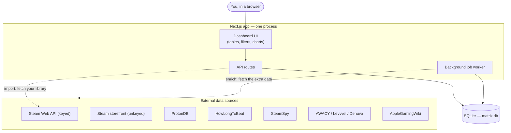
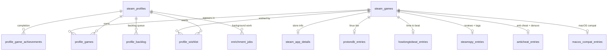
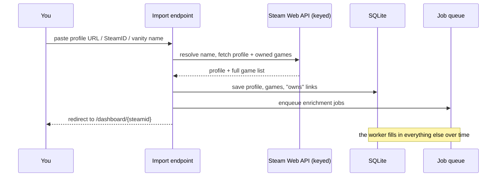
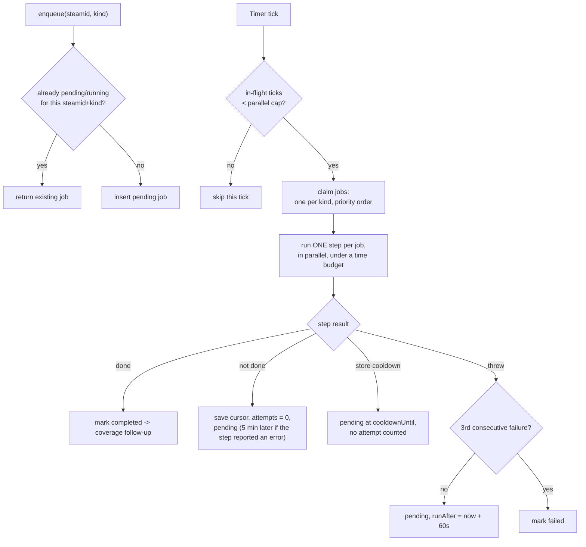
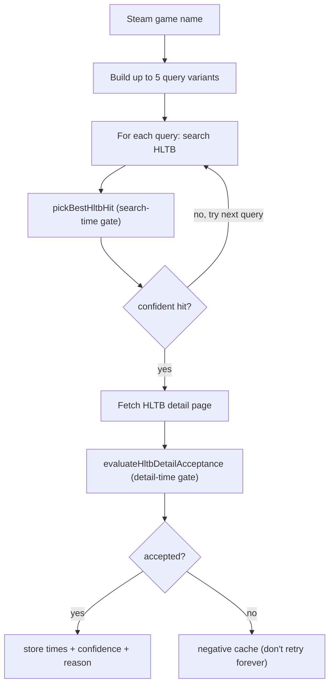
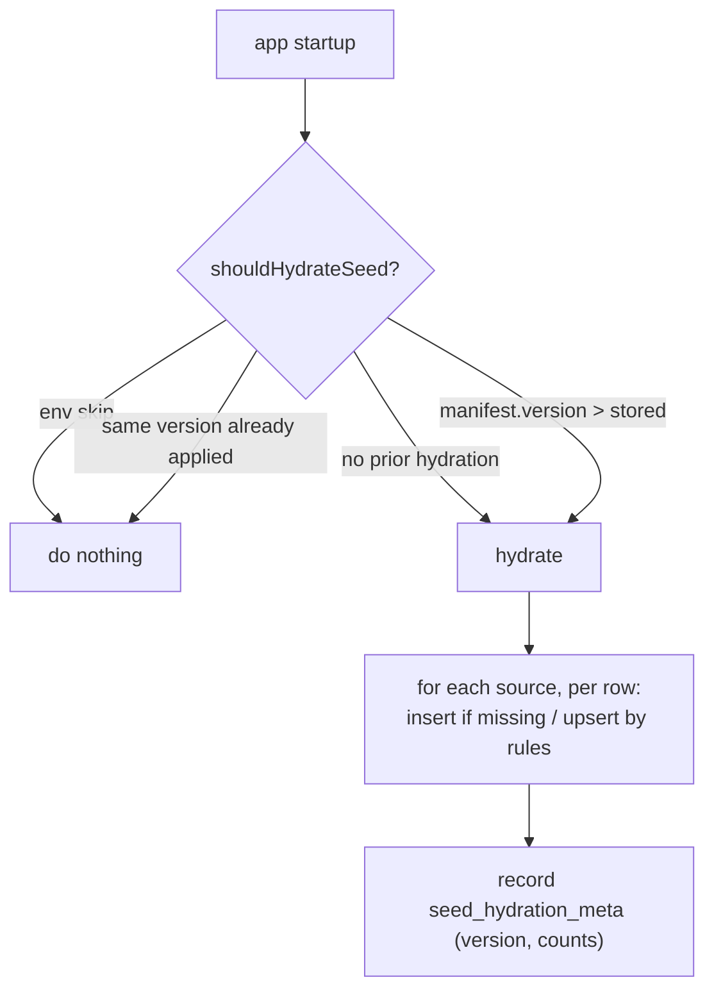

# Architecture

Steam Library Matrix is a self-hosted dashboard. It imports a public Steam library and
adds data Steam does not show in one place: Proton/Linux compatibility, anti-cheat and
Denuvo status, time to beat, Steam Deck rating, Mac and VR support, achievements, and
SteamSpy review and tag data. You can then search, filter, sort, and compare across all
of it.

There is no hosted backend. The runtime is one Next.js process and one SQLite file.

For setup and operations see [`README.md`](../README.md) and the other files in
[`docs/`](./README.md).

## 1. Design principles

- Page loads read only from local SQLite. All slow, rate-limited external fetching
  happens in a background worker.
- Importing a library takes one or two Steam calls. Enrichment is the slow part and runs
  asynchronously.
- If a third-party source is down, the affected column is empty for that game and the
  dashboard still loads.
- Background jobs are SQLite rows with saved cursors, so a restart resumes where it
  stopped.
- Cross-source matching is fuzzy, so the app stores how each match was made and how
  confident it was.
- A bundled seed dataset fills in popular games so a fresh install is not empty.

## 2. Tech stack

| Layer | Technologies |
| --- | --- |
| App framework | Next.js 16 (App Router), React 19, TypeScript |
| UI | Tailwind CSS 4, shadcn/ui (Base UI), Lucide icons, Recharts |
| Database | SQLite (`better-sqlite3`), Drizzle ORM, hand-written SQL migrations in `db/migrations/` |
| Background work | In-process enrichment worker (embedded in Docker, driven by a poller locally) |
| External data | Steam Web API, Steam storefront, ProtonDB, HowLongToBeat, SteamSpy, AWACY, Levvvel, Denuvo curator, AppleGamingWiki |
| Testing | Vitest (network tests isolated as `*.live.test.ts`) |
| Packaging | Node 22 + pnpm (local), Docker + Docker Compose (self-host) |

## 3. System overview

The web UI, the API routes, and the background worker run in the same Next.js process
and share one SQLite database.



The dashboard reads straight from SQLite. Data from external sources goes through the
worker, which controls concurrency, freshness (TTLs), and rate limiting.

## 4. Data sources

| Source | Provides | Access |
| --- | --- | --- |
| Steam Web API (`api.steampowered.com`) | Owned games, playtime, profile, achievements, wishlist | Official, keyed (`STEAM_API_KEY`) |
| Steam storefront (`store.steampowered.com`) | Genres, categories, platforms, release date, Steam Deck rating, Denuvo notices | Unofficial, unkeyed, throttled per IP |
| ProtonDB | Linux compatibility tier (platinum to borked) | Public API |
| HowLongToBeat | Time to beat (main, extras, completionist) | Scraped (no public API) |
| SteamSpy | Review counts, owner estimate, current players, user tags | Public API, about 1 request per second |
| AreWeAntiCheatYet (AWACY) | Whether anti-cheat works on Linux | Community catalog |
| Levvvel | Whether a game uses kernel-level anti-cheat | Community page (`table.kernel-table-grid`) |
| Denuvo (curator + store pages) | Denuvo anti-tamper presence | Curator list + store-page text |
| AppleGamingWiki | macOS: Apple Silicon (native), Rosetta 2, CrossOver ratings | Cargo API |

The two Steam hosts are different services. The Web API is keyed and has a generous
quota. The storefront ignores keys and limits by IP, and it is where rate-limit bans come
from. Categories, platforms, Deck rating, and Denuvo notices exist only on the
storefront, so the app throttles those calls. Limits, cooldowns, and fetch order are in
[`docs/scraping.md`](./scraping.md).

SteamSpy data feeds the Library Reviews column and game popover, the Backlog "Hidden
gems" list, the Overview "Library rating", and the Genres page's "Community tags" mode.

## 5. Data model

Each game is stored once in `steam_games`. Each source has its own table keyed by
`appid`. Profiles link to games through library and wishlist tables. The AWACY, Levvvel,
Denuvo, and AppleGamingWiki catalogs are fetched once globally.



| Table | Purpose |
| --- | --- |
| `steam_profiles` | Imported profiles (persona, avatar, level, country, sync timestamps) |
| `steam_games` | One row per app (name, icon, store URL) |
| `profile_games`, `profile_wishlist` | Library and wishlist links, with playtime on the library link |
| `steam_app_details` | Storefront details: type, genres, categories, platforms, release, Deck rating |
| `protondb_entries` | ProtonDB tier, confidence, report counts |
| `howlongtobeat_entries` | Beat times, matched name, match confidence |
| `steamspy_entries` | Positive/negative reviews, owners, current players, tags (migration `006_steamspy.sql`) |
| `anticheat_entries` | AWACY status, Levvvel kernel flag, Denuvo fields |
| `macos_compat_entries` | AppleGamingWiki ratings, name-matched per game |
| `profile_game_achievements` | Per profile/game completion |
| `profile_backlog`, `profile_backlog_goal` | Hand-picked play queue and monthly goal |
| `enrichment_jobs` | Background job queue (see §7) |
| `data_refresh_log` | Per-source refresh history for the UI |
| `awacy_catalog`, `levvvel_kernel_catalog`, `denuvo_anti_tamper_catalog`, `macos_compat_catalog` | Global catalogs |
| `anticheat_catalog_meta` | Catalog sync status and row counts |
| `steam_store_throttle` | Shared storefront request budget and cooldown |
| `seed_hydration_meta` | Which seed version has been applied (see §9) |

Deleting a profile cascades to its library, wishlist, and jobs. The schema is in
`src/lib/db/schema/index.ts`. Setup, migrations, and backups are in
[`docs/database.md`](./database.md).

## 6. Core workflows

### Importing a profile



`src/lib/steam/parse-steam-input.ts` extracts a SteamID or vanity name with a regex and
never fetches the URL you paste, so the endpoint has no SSRF surface. Import logic is in
`src/lib/steam/import-library.ts`.

### Enrichment

The UI, post-import, and full sync all enqueue jobs through `POST /api/jobs`, and the
worker drains them. There is no other enrichment path. See [§7](#7-the-job-worker).

### Viewing and filtering

For a dashboard request the server reads the library, wishlist, and every enrichment
table and joins them into one `DashboardGame[]` list. Filtering, sorting, search, and
pagination then run in the browser, with the current view stored in the URL.

The server side is `fetchDashboardPayload` in `src/lib/db/dashboard.ts`, the join query
in `src/lib/db/load-steam-game-join-rows.ts`, and row mapping in
`src/lib/db/map-dashboard-game.ts`. Dashboard pages: Overview, Library, Achievements,
ProtonDB, HowLongToBeat, Anti-cheat, Mac, VR, Genres, Compare, Random Picker / Backlog,
Data Status, and About.

The landing page (`src/app/page.tsx`) shows columns of game covers at the edges, picked
at random with no repeats. Dashboard pages use a plain background. The 404 page
(`src/app/not-found.tsx`) is an animated SVG scene.

## 7. The job worker

Enrichment means thousands of slow, rate-limited HTTP calls. They cannot run inside a web
request, cannot all run at once, and must survive a restart. The worker is a durable queue
stored in SQLite.

### Job kinds

The worker claims lower priority numbers first.

| Priority | Kinds | Notes |
| --- | --- | --- |
| 0 | `anticheat_catalog`, `denuvo_catalog` | Global catalogs that other steps depend on |
| 1 | `wishlist` | |
| 2 | `achievements` | |
| 3 | `anticheat` | Per-game anti-cheat and Denuvo matching |
| 4 | `protondb`, `app_details` | |
| 5 | `hltb` | Slow and fragile |
| 6 | `steamspy` | About 1 request per second |

`app_details`, `protondb`, `achievements`, `hltb`, and `steamspy` are registered sources
(`src/lib/enrichment/sources/`) and share one per-appid loop in `run-registered-step.ts`.
`wishlist`, `anticheat_catalog`, `denuvo_catalog`, and `anticheat` are bespoke steps in
`src/lib/jobs/run-step.ts`. How to add a source is in
[`docs/scraping.md`](./scraping.md#add-a-source-enrichmentsource-registry).

A job row has a `payload` (target appids, `cursor`, accumulated `stats`, flags such as
`force`, `missingOnly`, `anticheatPhase`, `followUpRound`) and a `progress` snapshot that
the UI polls.

### Lifecycle



Enqueue (`src/lib/jobs/enqueue.ts`) returns any existing `pending` or `running` job with
the same `(steamid, kind)`, so pressing Refresh repeatedly does not create duplicates. The
partial unique index `enrichment_jobs_one_active_per_kind` enforces the same rule under a
race.

Scheduling (`src/lib/jobs/worker-tick-scheduler.ts`): `scheduleEnrichmentWorkerTick()`
starts a tick without waiting for it and caps concurrent ticks at
`SLM_WORKER_PARALLEL_TICKS` (default 4), so ticks can overlap during network waits. In
Docker, `src/instrumentation.ts` runs the worker on an interval when
`SLM_EMBED_JOB_WORKER=true`. Locally, `scripts/dev-cron-loop.ts` drives it.

Claiming (`src/lib/jobs/worker.ts`) runs in an `IMMEDIATE` SQLite transaction. It selects
the highest-priority pending job whose `runAfter` has passed, then sets it to `running`
only if its status is still `pending`, with `lockedBy`/`lockedAt` and an incremented
`attempts`. Two workers cannot take the same row. A tick claims at most one job per kind
(up to `SLM_WORKER_MAX_JOBS_PER_TICK`), so a long ProtonDB job cannot starve
`app_details`.

Stepping: a step processes a slice of the appid list, starting at `cursor`, through
`runConcurrentBatch` (`src/lib/jobs/run-concurrent-batch.ts`). That runs N workers in
parallel, each checking the deadline before starting another item, with an optional
stagger. A step stops at the batch size or at `SLM_WORKER_TICK_BUDGET_MS` (default 50 s),
whichever comes first, and saves the new cursor and merged `stats`. A killed process
resumes from the saved cursor.


Outcomes:

- Done: the job is marked `completed` and a coverage follow-up runs.
- Not done: back to `pending` with the new cursor and `attempts` reset to 0. If the step
  reported an error, the error is kept on the row and the next run waits 5 minutes.
- `SteamStoreCooldownError`: back to `pending` with `runAfter` set to the cooldown's end.
  This does not count as an attempt.
- Any other thrown error: retry after 60 s. The third consecutive failure marks the job
  `failed`.
- Stale lock: `releaseStaleRunningJobs` resets any `running` job locked more than 10
  minutes ago.

On boot, `prepareWorkerOnBoot()` releases every job left `running` by a crash and deletes
finished jobs older than 7 days. It runs from `src/instrumentation.ts` (embedded worker),
from `scripts/dev-cron-loop.ts`, and once per process in `/api/cron/process-jobs` when the
worker is not embedded.

Coverage follow-ups (`src/lib/jobs/enqueue-coverage-followup.ts`) apply to `app_details`,
`protondb`, `hltb`, and `anticheat`. If a finished job had failures, it queues a
`missingOnly` retry. For `app_details` and `protondb` it also queues a gap-fill when
appids are still missing. Follow-ups stop after 3 rounds so appids that always fail do
not requeue forever. `denuvo_catalog` re-queues itself while the catalog is incomplete.

A game counts as done for a source once it has been checked, even when the answer is
empty: a delisted store page (404), a Deck rating of `unknown`, a game without
achievements (Steam 400/500), an HLTB title with no times, or an app SteamSpy does not
know. These results are stored with a timestamp (a negative cache) and are not counted as
failures, so the queue drains and Data Status reaches 100%. Only transient errors such as
rate limits and timeouts are retried.

The `anticheat` job has two phases. `phase: "catalog"` matches every game against the
in-memory AWACY and Levvvel catalogs with no per-game network calls. When that cursor
finishes, the same job resets its cursor and switches to `phase: "denuvo"`, the
throttled store-page scrape.

## 8. Matching logic

Community sources key data by game name, and names rarely line up: Steam has
`ELDEN RING™`, HowLongToBeat has `Elden Ring`, a catalog may have
`Elden Ring: Shadow of the Erdtree`.

`normalizeGameName` (`src/lib/utils/normalize-game-name.ts`) lowercases, strips `™®©:`,
collapses whitespace, removes other non-alphanumerics, and trims. Every exact-name lookup
uses this form.

### Denuvo

`src/lib/steam/denuvo/score-denuvo-status.ts` combines two signals, store-page DRM
notices and the Denuvo curator list:

```
store says "Denuvo Anti-Tamper"               -> true,  HIGH   (store_page)
store says Denuvo "removed"                    -> false, HIGH   (removal_confirmed)
store checked, no Denuvo, but curator lists it -> true,  MEDIUM (curator)
only curator lists it (store unchecked)        -> true,  MEDIUM (curator)
neither                                        -> null,  NONE
```

`src/lib/steam/denuvo/resolve-denuvo-display-state.ts` maps stored fields to a display
state:

| Stored | Display (tooltip / badge) |
| --- | --- |
| true + high | Denuvo detected / Detected |
| true + medium or low | Possible Denuvo / Possible |
| false + high + store or removal signal | No active Denuvo confirmed / None |
| anything else | DRM status unknown / Unknown |

A `false` shows as confirmed absent only with a high-confidence store signal. Tooltips
note that Steam does not reliably expose third-party DRM.

### Anti-cheat

`src/lib/anticheat/anticheat-indexes.ts` loads the catalogs into a `bySteamAppId` map, a
`byName` map, and a flat array for fuzzy search. `src/lib/anticheat/match-from-indexes.ts`
tries, in order:

```
1. Steam app ID match    -> confidence "appid"
2. Exact normalized name -> confidence "exact-title"
3. Fuzzy (Levenshtein >= 0.85 over all entries) -> "fuzzy-title"
   else -> "none"
```

AWACY and Levvvel are matched separately and merged. A result is saved only if it has a
real status, named anti-cheats, or a definite kernel yes/no.

### HowLongToBeat

HLTB has no public API. The client (`src/lib/enrichment/hltb-client.ts`) finds the search
endpoint by reading HLTB's app JS bundle and looking for the `/api/.../init?` call
(currently `api/search/site`, also the fallback). It gets a token from that `init` URL.
Concurrent callers share one session fetch, and a 401/403 drops the session and retries
once. Searches include DLC (`modifier: ""`) because Steam lists expansions as their own
apps. Transient errors return `retryable` and are not negative-cached.

Search results often include the game's Steam app ID, which settles the match when
present.



Query variants (`resolveHltbSearchQueries` in `src/lib/enrichment/hltb-match.ts`): the
cleaned name, the name without an edition suffix, the part before a subtitle colon, the
base title (edition stopwords such as *definitive*, *goty*, *remastered* removed), and the
base title without a leading "the". The first confident hit wins.

Search-time gate (`pickBestHltbHit`):

1. A hit with the same Steam ID: confidence 1.
2. Exact normalized name: confidence 1.
3. Same base title: at least 0.82.
4. Otherwise the best score, `nameSimilarity·0.65 + tokenOverlap·0.35` plus 0.15 when
   base titles match. The score is multiplied by 0.75 when overlap and similarity are both
   weak and by 0.4 when the hit links a different Steam ID. A subtitle rule raises the
   score to 0.72 when the hit's title before a colon or dash equals the Steam name and
   that name has more than one word or contains a digit ("WRC 7" matches
   "WRC 7: World Rally Championship"; "Doom" alone does not). Ties go to the hit with
   more community data. The minimum is 0.55 (`HLTB_MIN_CONFIDENCE`).

Detail-time gate (`evaluateHltbDetailAcceptance`), checked in order:

| Evidence | Result |
| --- | --- |
| Detail page's Steam ID equals the appid | accept, confidence 1 (`steam_id`) |
| Edition variant (same base, extra words are all stopwords) | accept (`edition_variant`) |
| Same base title and search confidence ≥ 0.62 | accept (`base_title`) |
| Detail page links a different Steam ID | reject |
| Search confidence ≥ 0.72 | accept (`search_confidence`) |
| Otherwise | reject |

Rejections are negative-cached so the worker does not retry them.

### macOS (AppleGamingWiki)

AppleGamingWiki's Cargo table has no Steam app ID, so matching uses the name only. Each
library game tries an exact normalized-name hit (`exact-title`), then a fuzzy match
(`fuzzy-title`) (`src/lib/mac/sync-macos-compat.ts`). The `native`, `rosetta_2`,
`crossover`, and `parallels` fields map to `perfect`, `runs`, `menu`, `unplayable`, `na`,
or `unknown`. Matching runs after import and after seed hydration, not as a worker job.

## 9. The seed system

The seed ships precomputed data for about 2,200 popular games so the dashboard is useful
before the worker catches up and every install does not re-scrape the same games.

### Choosing and generating

`src/lib/seed/resolve-target-appids.ts` takes the appids from `--appids-file` if given,
otherwise merges `data/seed/top-appids.json` (Steam top sellers) and
`profile-appids.json` (real libraries), and falls back to every appid already in the
local DB. `pnpm seed:generate` (`scripts/generate-seed-metadata.ts`) fetches ProtonDB and
HLTB data into the local DB with throttling (`src/lib/seed/prefetch-seed-enrichment.ts`),
then exports what the local DB knows. The seed is a snapshot of a well-enriched local
database. The file list is in [`docs/scraping.md`](./scraping.md#bundled-seed-metadata).

### Hydrating on startup



`src/lib/seed/should-hydrate-seed.ts` re-runs hydration only when the bundled
`manifest.version` is greater than the one in `seed_hydration_meta`. Any change to seed
content must bump `SEED_MANIFEST_VERSION` in `src/lib/seed/types.ts`, or existing
installs ignore it. `src/lib/seed/load-seed-files.ts` validates each file with zod,
skips missing optional files, and collects warnings instead of throwing.

`src/lib/seed/upsert-rules.ts` treats the seed as a starting point:

- `shouldApplySeedTimestamp` applies a seed row only if its `checkedAt` is newer than the
  existing `lastCheckedAt`, so live data is never overwritten by older bundled data.
- `shouldApplySeedDenuvoRow` never overwrites live Denuvo data that is newer or more
  confident.
- When seed Denuvo data creates or updates an anti-cheat row with no AWACY data yet,
  hydration sets `lastCheckedAt = null` so the live AWACY pass still runs.

For Docker, `scripts/build-docker-db-template.ts` runs migrate and hydrate at build time
and saves `docker/db/matrix.db.template` into the image. On first start the entrypoint
copies it in, so the container starts fully seeded.

## 10. Running it

| | Local (development) | Docker (self-hosting) |
| --- | --- | --- |
| Run | `pnpm dev:all`: web server + `scripts/dev-cron-loop.ts` poller | One container, worker embedded (`SLM_EMBED_JOB_WORKER=true`) |
| Database | `./data/matrix.db` | Named volume, seeded from the baked template |
| Port | Next.js dev server | `3001` (reachable from the LAN) |

Do not set `SLM_EMBED_JOB_WORKER` locally. Both setups need a Steam Web API key, and the
imported profile must be public. Docker setup is in
[`docs/self-hosting.md`](./self-hosting.md). Tuning variables are in
[`docs/env.md`](./env.md).

## 11. Security

The app is single-user and meant for a LAN. Details are in
[`docs/security.md`](./security.md).

- `src/proxy.ts` and `src/lib/security/csp.ts` set a nonce-based CSP with
  `strict-dynamic` (no `upgrade-insecure-requests`). Two sha256 hashes allow the style tag
  Sonner injects. The proxy also sets `X-Frame-Options`, `X-Content-Type-Options`,
  `Referrer-Policy`, `Permissions-Policy`, and HSTS in production.
- `src/lib/api/with-api-route.ts` rejects cross-origin non-GET requests by comparing
  `Origin` with `Host`, then applies rate limiting.
- `src/lib/api/rate-limit.ts` keeps one global bucket per tier (`default`, `expensive`),
  not per IP, because `X-Forwarded-For` can be spoofed.
- Request bodies are validated with zod. Steam input parsing extracts only an ID or vanity
  name.
- `/api/cron/process-jobs` requires `CRON_SECRET`. Other API routes are open
  (rate-limited), so keep the app on your LAN.
- The Docker container publishes port 3001 to the LAN, drops all capabilities except the few
  the entrypoint needs, and sets `no-new-privileges`.

## 12. File map

| Area | Key files |
| --- | --- |
| Database client / schema | `src/lib/db/client.ts`, `src/lib/db/schema/index.ts`, `db/migrations/` |
| Dashboard read path | `src/lib/db/dashboard.ts`, `src/lib/db/load-steam-game-join-rows.ts`, `src/lib/db/map-dashboard-game.ts` |
| Job worker | `src/lib/jobs/worker.ts`, `run-step.ts`, `run-concurrent-batch.ts`, `enqueue.ts`, `worker-tick-scheduler.ts`, `enqueue-coverage-followup.ts`, `batch-config.ts` |
| Source registry | `src/lib/enrichment/sources/*` |
| Enrichment resolution / TTL | `src/lib/enrichment/resolve-enrichment-appids.ts`, `src/lib/enrichment/enrichment-ttl.ts` |
| Steam APIs | `src/lib/steam/steam-api.ts` (keyed), `steam-store.ts` / `steam-store-fetch.ts` / `fetch-steam-deck-compatibility.ts` (storefront) |
| ProtonDB / HLTB / SteamSpy | `src/lib/enrichment/protondb.ts`, `hltb-client.ts`, `hltb-match.ts`, `steamspy.ts` |
| Anti-cheat / Denuvo | `src/lib/anticheat/*`, `src/lib/steam/denuvo/*` |
| macOS (AppleGamingWiki) | `src/lib/mac/*`, `src/lib/db/macos-compat.ts` |
| Backlog | `src/lib/dashboard/backlog.ts`, `src/lib/db/profile-backlog.ts` |
| Seed system | `src/lib/seed/*`, `scripts/generate-seed-metadata.ts`, `scripts/build-docker-db-template.ts` |
| Security / env | `src/proxy.ts`, `src/lib/security/csp.ts`, `src/lib/api/*`, `src/lib/env/runtime-env.ts` |
| Startup / worker embed | `src/instrumentation.ts` |

For planned work see the "Planned" section of [`README.md`](../README.md).
